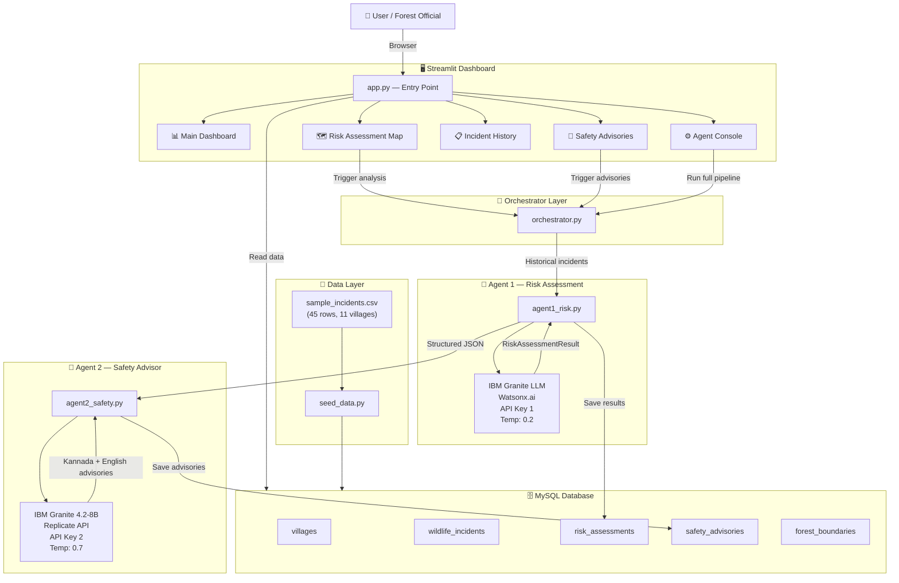
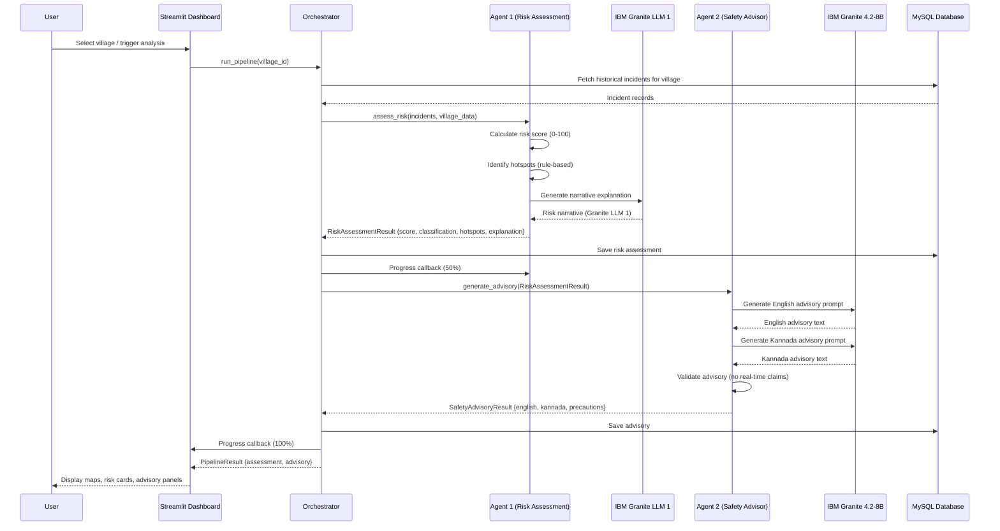
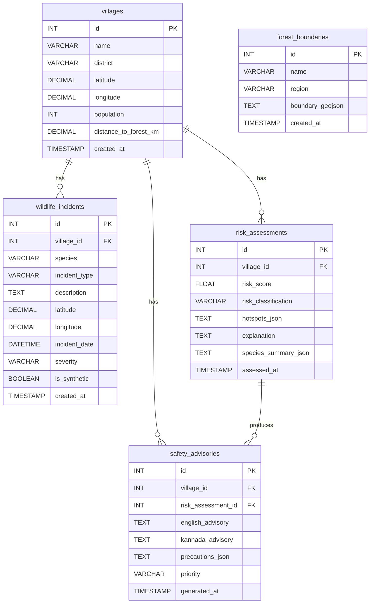
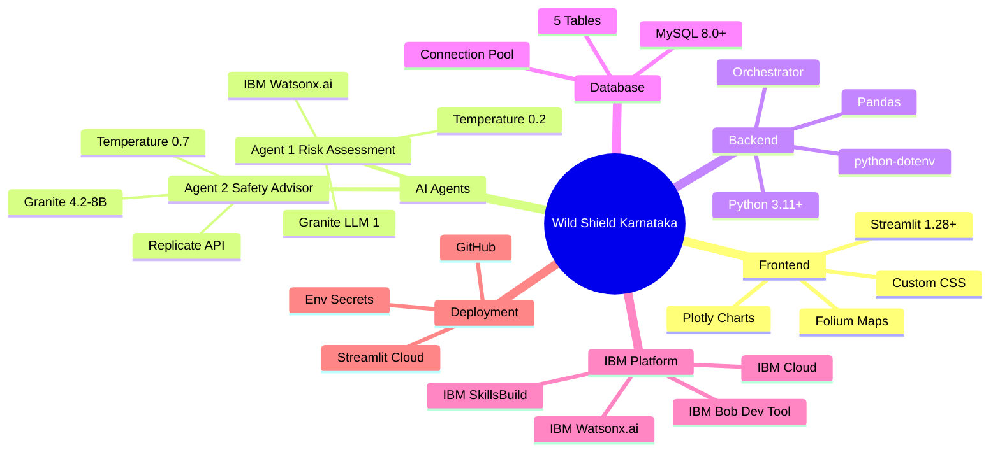
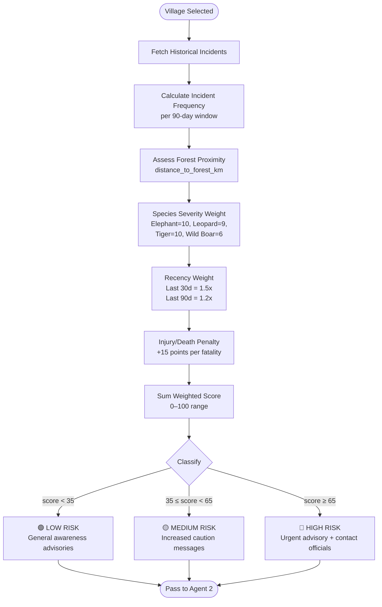
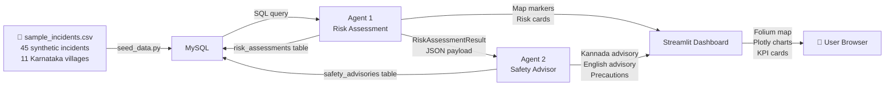

# Wild Shield Karnataka — System Architecture

> All diagrams rendered as Mermaid. GitHub, GitLab, and Mermaid Live (mermaid.live) will render these automatically.

---

## 1. High-Level System Architecture

---

## 2. Agent Communication Workflow

---

## 3. Database Schema

---

## 4. Technology Stack Overview

---

## 5. Risk Scoring Logic

---

## 6. Data Flow Summary

